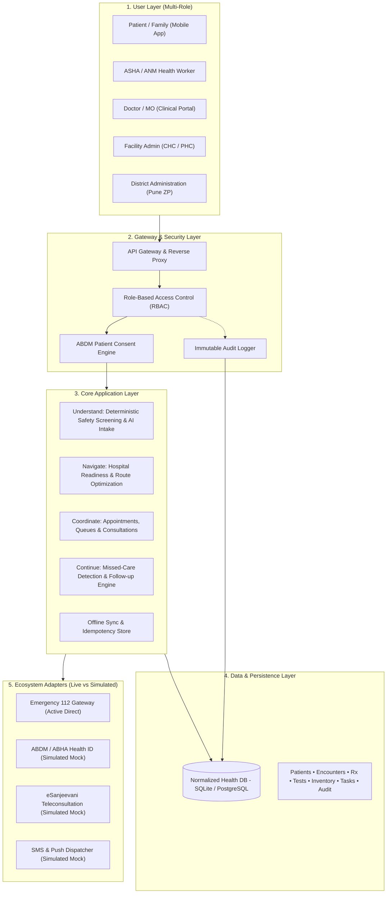

# SwasthyaSetu AI — Architecture & Domain Model

## 1. System Architecture Overview

---

## 2. 4 Core Pillars

1. **UNDERSTAND**: Multilingual text and speech intake in Hindi and English. Immediate deterministic screening of life-threatening cardiac, respiratory, neurological, and trauma symptoms, taking precedence over appointment booking.
2. **NAVIGATE**: Transparent facility readiness showing verified travel times, doctor roster timestamps, diagnostic test hardware availability, and medicine inventory status. Lacking tests or out-of-stock medicines are explicitly surfaced with regional referral alternatives.
3. **COORDINATE**: Digital consultations, queue management tokens, e-prescriptions, diagnostic test orders, and longitudinal digital health timelines linked to ABHA IDs.
4. **CONTINUE**: Missed-care detection algorithms that monitor scheduled review dates. Unattended chronic care cases automatically spawn high-priority home visit tasks for village ASHA workers with structured resolution tracking.

---

## 3. Database Domain Model Entities (28 Normalized Tables)

| Entity | Primary Attributes | Role in Continuity |
|---|---|---|
| `User` | id, username, full_name, role, village, facility_id | Authentication & RBAC actor |
| `Patient` | id, abha_id, name, age, village, assigned_asha_id | Longitudinal subject of care |
| `FamilyMember` | id, patient_id, full_name, relationship, conditions | Household health profiling |
| `ConsentRecord` | id, patient_id, granted_to_role, purpose, status | ABDM data sharing privacy |
| `Facility` | id, name, facility_type, distance_km, verified_at | Verified physical health center |
| `Doctor` | id, facility_id, name, specialty, is_available_today | Attending clinical provider |
| `Appointment` | id, appointment_code, queue_token, idempotency_key | Point of consultation access |
| `QueueEntry` | id, facility_id, token_number, estimated_wait_mins | OPD wait time management |
| `SymptomIntake` | id, raw_input, language, triage_level, emergency_triaged | Structured input & safety triage |
| `ClinicalEncounter` | id, diagnosis, vitals (BP, pulse, temp, spo2), risk_flag | Qualified doctor encounter record |
| `Prescription` | id, prescription_code, doctor_id, patient_id | Digital e-prescription container |
| `PrescriptionItem`| id, medicine_name, dosage, frequency, collected_status | Drug dispensing & stock tracking |
| `DiagnosticTest` | id, test_code, name, category, standard_turnaround | Catalog of laboratory & radiology tests |
| `DiagnosticOrder`| id, test_name, status, scheduled_date | Investigation lifecycle |
| `InventorySnapshot`| id, facility_id, medicine_id, stock_status, quantity | Verified local stock availability |
| `FollowUpPlan` | id, due_date, instructions, status (SCHEDULED, OVERDUE) | Continuity contract |
| `Reminder` | id, channel, message, scheduled_time, status | Patient adherence notification |
| `HealthWorkerTask`| id, asha_worker_id, priority, visit_notes, outcome | ASHA field action & escalation |
| `CareTimelineEvent`| id, event_type, title, description, actor_name, role | Immutable chronological journey |
| `SyncOperation` | id, idempotency_key, action_type, payload, status | Offline replay duplicate prevention |
| `AuditEvent` | id, action, resource_type, outcome, user_name, role | Governance, RBAC & compliance audit |

---

## 4. Simulated vs Live Services

| Integration Component | Implementation Status | Behavior in Prototype |
|---|---|---|
| **National Emergency 112** | Active Direct Protocol | Triggers immediate emergency banner, displays 112 direct dialers and nearest 24x7 emergency-ready facility. |
| **Safety Triage Engine** | Deterministic Local Engine | Ruleset covering acute coronary, respiratory, and stroke red flags in Hindi and English. Never delays emergency advice for questionnaire completion. |
| **ABDM / ABHA ID** | Deterministic Mock Adapter | Generates compliant 14-digit ABHA IDs and enforces consent boundaries. |
| **eSanjeevani Teleconsult** | Deterministic Mock Adapter | Prepares standardized consultation payloads and teleconsultation token dispatch. |
| **Dispensary Inventory** | Live Seeded State Machine | Tracks physical inventory (e.g. Paracetamol available, Amlodipine out of stock) without AI modifying clinical prescriptions. |
| **ASHA Field Tasks** | Automated Event Driven | Overdue follow-up triggers task generation; resolved home visit updates dashboard indicators. |
| **Offline Synchronization** | IndexedDB / LocalStorage Queue | Captures offline actions, assigns stable idempotency keys, and reconciles batches without duplication. |
